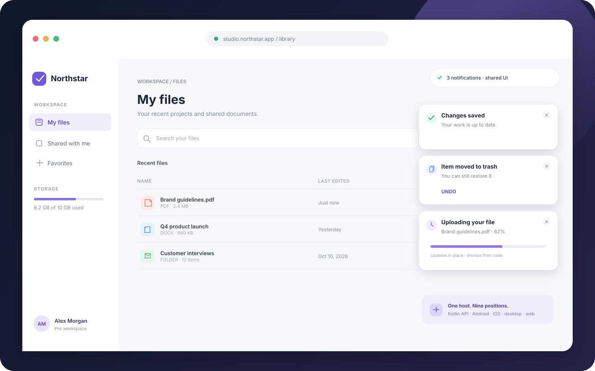
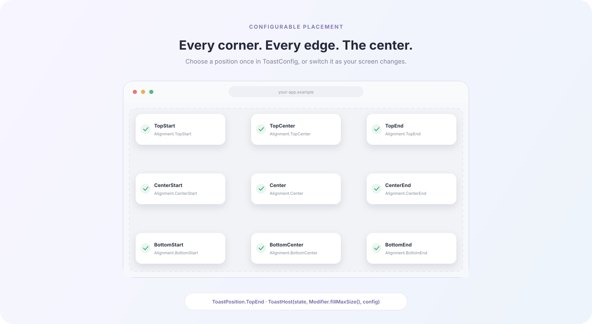
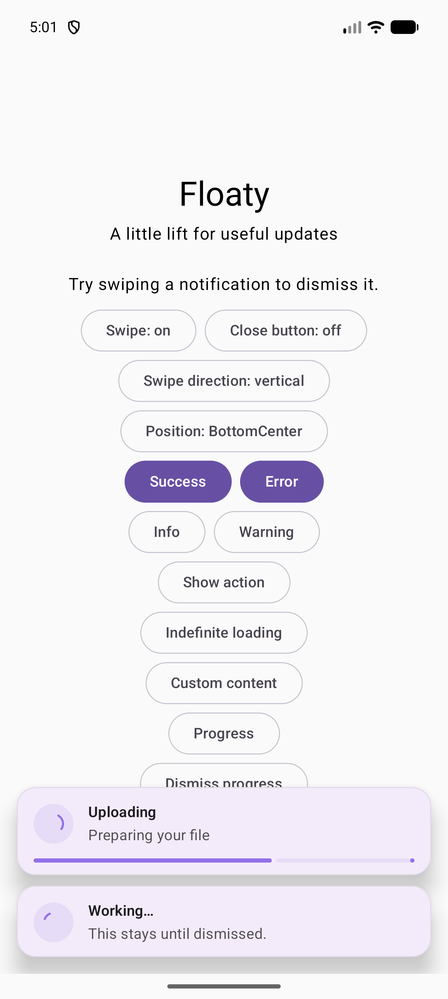
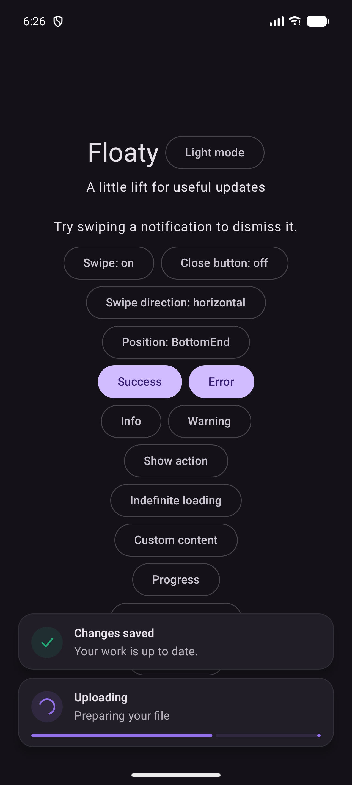
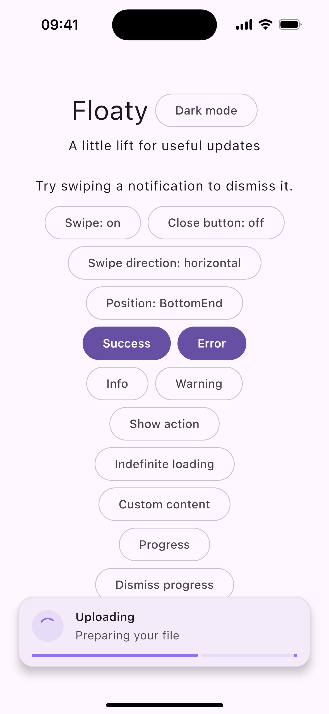
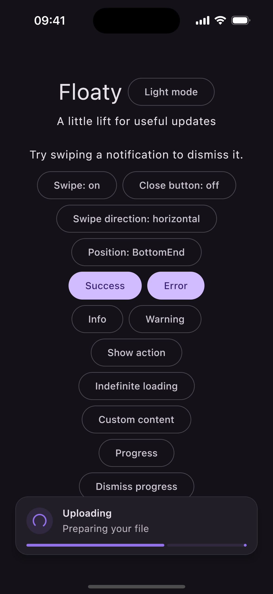

# Floaty

[](https://github.com/hosseinkarami-dev/floaty-compose/actions/workflows/ci.yml)
[](https://jitpack.io/#hosseinkarami-dev/floaty-compose)

<p align="center">
  <strong>Thoughtful, customizable toast notifications for Compose Multiplatform.</strong><br>
  One small API for Android, iOS, desktop, and web Compose interfaces.
</p>

Floaty displays in-app notifications in a Compose overlay. It gives the app control over message state, placement, appearance, actions, progress, and dismissal while keeping the UI in shared Kotlin code.

> **Status:** stable. `v0.1.7` is the current JitPack release, and Floaty works on Android, iOS, desktop, and web.

## Preview

Floaty notifications sit over your app UI. The preview shows success, undo action, and upload progress states together; placement can be configured independently for each host.



All nine supported host positions:



### Android and iOS themes

The shared Compose sample includes a Light/Dark mode switch. These emulator and simulator screenshots show the toast surface in both themes:

<p align="center"><strong>Android</strong><br>
  
  &nbsp;&nbsp;
  
</p>

<p align="center"><strong>iOS</strong><br>
  
  &nbsp;&nbsp;
  
</p>

Android Studio also provides dedicated Light and Dark previews with live success and upload notifications.

## Highlights

- Shared `ToastState` with a FIFO queue and stable IDs for updates and programmatic dismissal.
- Semantic styles for default, success, error, warning, info, and loading messages.
- Short, medium, long, custom, and indefinite durations. Timers start when a message becomes visible.
- Optional action, determinate progress, and fully custom composable content.
- Nine screen positions, safe drawing insets, Material theme colors, and per-message accent colors.
- Optional gesture dismissal with axis locking, edge-aware vertical gestures, direction and threshold controls.
- Animated entrance and exit, with a duration setting that can turn motion off.
- No required icon library or platform toast API.

## Compatibility

| Target | Gradle target configured | Status |
| --- | --- | --- |
| Android | Android | Stable; CI builds the sample APK |
| iOS | `iosArm64`, `iosSimulatorArm64` | Stable; CI compiles both targets on macOS |
| Desktop | JVM | Stable; CI compiles the sample |
| Browser | JS, WasmJS | Stable; CI compiles both web outputs |

Floaty uses Compose Multiplatform and the consumer's `MaterialTheme`. See [platform notes](docs/PLATFORM_SUPPORT.md) for current constraints.

## Installation

Floaty is available from JitPack. The current release is `v0.1.7`; use a later release tag when upgrading.

In `settings.gradle.kts`:

```kotlin
dependencyResolutionManagement {
    repositories {
        maven("https://jitpack.io")
    }
}
```

In the consuming module's `build.gradle.kts`:

```kotlin
dependencies {
    implementation("com.github.hosseinkarami-dev.floaty-compose:floaty:v0.1.7")
}
```

The release exposes Android, iOS device/simulator, JVM, JS, and WasmJS modules. CI validates the Linux publication and macOS iOS compilation; test the artifact in your own target app as part of adoption. See the [publishing guide](docs/PUBLISHING.md).

## Quick start

Place one `ToastHost` near the root of the UI you want it to overlay, and keep its state where callbacks can access it:

```kotlin
@Composable
fun App() {
    val toastState = rememberToastState()

    Box(Modifier.fillMaxSize()) {
        AppContent(
            onSave = {
                toastState.showSuccess("Changes saved", "Your updates are ready.")
            },
        )
        ToastHost(
            state = toastState,
            modifier = Modifier.fillMaxSize(),
        )
    }
}
```

By default, the host respects safe drawing insets, placing notifications clear of system bars, display cutouts, and supported safe areas. Set `respectSafeDrawingInsets = false` if the parent already handles those insets. Desktop and browser insets depend on the host environment.

## Message types and duration

```kotlin
toastState.showInfo("Update ready")
toastState.showWarning("Unsaved changes")
toastState.showError("Upload failed", "Check your connection and try again.")

val uploadId = toastState.show(
    ToastMessage(
        title = "Uploading file…",
        kind = ToastKind.Loading,
        duration = ToastDuration.Indefinite,
        progress = 0.35f,
    ),
)

// Update the same visible message as progress changes.
toastState.show(
    ToastMessage(
        id = uploadId,
        title = "Uploading file…",
        kind = ToastKind.Loading,
        duration = ToastDuration.Indefinite,
        progress = 0.8f,
    ),
)

// Dismiss it from any callback that can access the state.
toastState.dismiss(uploadId)
```

`ToastKind` values are `Default`, `Success`, `Error`, `Warning`, `Info`, and `Loading`. Durations are `Short` (2 seconds), `Medium` (3.5 seconds), `Long` (5 seconds), `Custom(milliseconds)`, and `Indefinite`. `ToastDuration.Indefinite` is useful for progress or messages that must wait for an explicit decision. Use `dismiss(id)` or `dismissAll()` at any time.

Messages sharing an explicit `id` update in place. Otherwise, Floaty creates an ID. `rememberToastState(maxVisible = 3)` controls how many messages render at once; additional messages wait in FIFO order. A queued message's timeout starts only when it becomes visible.

## Actions and custom content

```kotlin
toastState.show(
    ToastMessage(
        title = "Item moved to trash",
        action = ToastAction("Undo") { restoreItem() },
        duration = ToastDuration.Long,
    ),
)
```

Use `ToastMessage.content` when the built-in title/description layout is not enough. Floaty keeps the host surface, safe-area placement, animation, and dismissal handling around the custom composable:

```kotlin
toastState.show(
    ToastMessage(
        title = "Custom status",
        content = {
            Row(verticalAlignment = Alignment.CenterVertically) {
                CircularProgressIndicator(Modifier.size(18.dp))
                Spacer(Modifier.width(12.dp))
                Text("Syncing your library…")
            }
        },
    ),
)
```

Custom content is responsible for its internal layout, semantics, and any controls it needs. `progress` adds a built-in determinate progress bar for the standard message layout.

## Placement and appearance

`ToastConfig` supports all nine screen positions: top, center, and bottom crossed with start, center, and end (left/right follow RTL). It also controls item spacing; host padding; maximum width; surface, content, and border colors; elevation; safe insets; close-button visibility; and animation duration. Material theme colors are used by default, so the host follows the app's light or dark scheme. Override an individual semantic color with `ToastMessage.accent`.

```kotlin
ToastHost(
    state = toastState,
    modifier = Modifier.fillMaxSize(),
    config = ToastConfig(
        position = ToastPosition.BottomCenter,
        maxWidth = 520.dp,
        elevation = 10.dp,
        animationDurationMillis = 180,
    ),
)
```

Set `animationDurationMillis = 0` to disable entrance and exit motion. Close-button text is configurable with `dismissActionLabel`; pass a localized label when localizing the host.

## Gesture dismissal

Swipe-to-dismiss is opt-in and applies to dismissible messages:

```kotlin
ToastHost(
    state = toastState,
    modifier = Modifier.fillMaxSize(),
    config = ToastConfig(
        swipeToDismiss = true,
        swipeDirection = ToastSwipeDirection.Vertical,
        swipeThreshold = 72.dp,
        showDismissButton = false,
    ),
)
```

`ToastSwipeDirection` supports `Horizontal`, `Vertical`, `Any`, `Left`, `Right`, `Up`, `Down`, `StartToEnd`, and `EndToStart`. The gesture locks to one axis; the toast does not follow diagonal movement. `Vertical` and the vertical component of `Any` follow the nearest screen edge at top and bottom positions; from a centered position, either vertical direction is allowed. Horizontal gestures stay horizontal. Directional choices restrict movement to their selected direction, and start/end adapt to RTL. The distance required to dismiss is configurable. Mark a message `dismissible = false` to prevent button and gesture dismissal; it can still be removed through `ToastState.dismiss`.

## Accessibility and localization

Built-in controls use Compose semantics and buttons; semantic variants also have distinct marks so meaning does not rely on color alone. Provide localized button labels with `dismissActionLabel`, and localize message text and action labels in the app. Custom message content should expose its own useful semantics. Check the [API guide](docs/API_GUIDE.md) and [platform notes](docs/PLATFORM_SUPPORT.md) for details.

## Build from source

```sh
./gradlew :floaty:allTests
./gradlew :floaty:compileAndroidMain :floaty:compileKotlinJvm :floaty:compileKotlinJs :floaty:compileKotlinWasmJs
```

The iOS targets need macOS and Xcode for final binary compilation. Runnable examples live in `:shared`, with platform launchers in the app modules. See [contributing](CONTRIBUTING.md) for the local workflow.

## License

Floaty is available under the [MIT License](LICENSE).

## Documentation

- [API and customization guide](docs/API_GUIDE.md)
- [Platform support and compatibility](docs/PLATFORM_SUPPORT.md)
- [Architecture](docs/ARCHITECTURE.md)
- [JitPack publishing and release checklist](docs/PUBLISHING.md)
- [Changelog](CHANGELOG.md)
